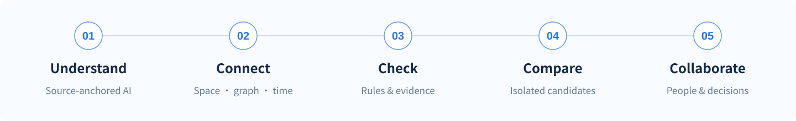

<p align="center">
  <picture>
    <source media="(prefers-color-scheme: dark)" srcset="docs/assets/readme/hero-dark.svg">
    
  </picture>
</p>

<h3 align="center">Scenario-aware AI pre-review for university laboratories</h3>
<p align="center">Connecting experiment semantics, spatial context and decision workflows with AI.</p>

<p align="center">
  <a href="#overview"></a>
  <a href="#spatial"></a>
  <a href="#architecture"></a>
  <a href="#architecture"></a>
  <a href="#architecture"></a>
  <a href="https://github.com/fanyangzi/AegisLab/actions/workflows/desktop-web.yml"></a>
</p>

<p align="center"><a href="README.md">简体中文</a> · <strong>English</strong></p>
<p align="center">
  <a href="#overview">Overview</a> ·
  <a href="#highlights">Highlights</a> ·
  <a href="#spatial">AI + Spatial Modeling</a> ·
  <a href="#workflow">Workflow</a> ·
  <a href="#quick-start">Quick Start</a> ·
  <a href="#architecture">Architecture</a>
</p>

<p align="center">
  <a href="docs/assets/readme/workspace.png"></a>
  <br><sub>Spatial workspace · Complete product interface · Example workspace</sub>
</p>

<a id="overview"></a>
## Overview

**AegisLab (实验哨兵, Lab Sentinel)** is a **scenario-aware AI pre-review platform** for university laboratories. It combines LLM-powered semantic modeling with 3D workspaces, relationship graphs, evidence checks and what-if analysis, turning experiment descriptions into connected information that people can analyze and act on together.

Laboratory pre-review needs to establish **what an experiment involves, which resources it needs, which conditions support it and what changes would affect those conditions**. AegisLab organizes SOP steps, materials, equipment and control cues into source-anchored semantic structures, then connects them to resource records, use intervals and check results. Researchers, instructors and laboratory staff can work from a shared understanding of the scenario through to an informed review decision.

> **AI + Scenario Innovation: bring experiments out of static documents into connected digital scenarios for what-if analysis and collaborative decisions.**

Current examples focus on university chemistry, sample preparation and analytical testing. The website serves experiment authors, instructors, equipment administrators and authorized reviewers.

<a id="highlights"></a>
## Highlights

| Capability | Core mechanism | Application value |
| :--- | :--- | :--- |
| **LLM-powered experiment semantic modeling** | Combines model extraction, source anchoring and structural validation to organize steps, materials, equipment and controls while preserving negated, proposed and unconfirmed information. | Makes natural-language experiment descriptions usable in a structured pre-review process. |
| **Semantic-to-spatial grounding** | Maps equipment references to resource records and 3D objects, linking steps, dependencies and use intervals. | Grounds semantic analysis in a specific laboratory, resource and operating context. |
| **Evidence-grounded assessment** | Combines model explanations, rule results and resource evidence; checks identity, specifications and validity intervals, with graph paths to related conditions and sources. | Explains the affected objects, supporting rationale and evidence gaps behind a finding. |
| **What-if scenario analysis** | Organizes isolated candidates around alternative equipment, schedule changes and evidence follow-up; recalculates constraints and compares impacts before editing or submission. | Shows which conditions and follow-up work would change before updating the official plan. |
| **Context-linked action proposals** | Binds suggestions to source passages, equipment and check results, connecting analysis to source inspection, spatial navigation, evidence tasks and candidate scenarios. | Takes AI-assisted analysis beyond an explanation into a workflow the user can continue. |
| **Human–AI decision workflows** | Connects assignment, evidence verification and approval through authorized confirmation, retaining decision grounds and updating review status as related conditions change. | Keeps pre-review, collaboration and ongoing reassessment centered on the same experiment. |

### AegisLab Copilot · From Semantics to Action

Copilot organizes a pre-review into three connected outputs: **experiment semantics** (steps, materials and control cues), **assessment context** (rule results, resource evidence and source locations), and **action proposals** (locating objects, collecting evidence, creating candidates and requesting review). Model interpretation and explanation work alongside scene queries and rule checks, allowing users to confirm and advance the next action without losing context.

**The value is not just an answer, but its connection to experiment objects, decision grounds and follow-up action.**

<a id="spatial"></a>
## AI + Spatial Modeling: From Geometry to a Semantic Workspace

**Geometry establishes where things are. Semantics connect what happens, what it depends on and why it needs attention.**

Room dimensions, equipment types and layout configuration form the 3D space. Experiment semantics, resource references, check results and action entry points form the business layer. Shared equipment and plan identities connect these layers, giving each object a spatial location, an experiment context and a traceable handling history.

| Three views of one workspace | What the view contributes |
| :--- | :--- |
| **Space** | Places experiment steps and equipment dependencies in the laboratory; selecting an object opens its related plans and available actions. |
| **Graph** | Traces dependencies and evidence across plans, steps, resources, conditions and records, with neighborhood, type and path queries. |
| **Timeline** | Examines capacity, maintenance windows and evidence validity over intended use intervals, supplying constraints for schedule changes. |

All three views share plan, equipment and workspace data. Copilot's object and source actions resolve to those same identities. Users can locate a finding in space, trace its evidence through relationships and compare timing or candidate scenarios without reconstructing the context.

**Space locates. Graphs connect. Time frames the constraints. Copilot connects analysis to action.**

<a id="workflow"></a>
## From Scenario Understanding to Review Decisions

<p align="center"></p>

1. **Model experiment semantics:** import TXT, Markdown, DOCX or a text-based PDF; derive steps, objects and control cues as source-anchored structures for confirmation.
2. **Ground the scenario:** connect confirmed equipment references to laboratory resources, allocations, inspection records and object relationships.
3. **Assess with evidence:** rules check concrete conditions, models help explain risks and gaps, and graph paths connect findings to related objects and sources.
4. **Explore alternatives:** create resource, time or evidence-follow-up candidates and compare check results and affected work before and after the proposed change.
5. **Coordinate the decision:** users adopt proposals and advance tasks; authorized people complete the review, while the system retains its history and rechecks related conditions as they change.

For example, an SOP involves solvent handling, a fume hood and equipment inspection records. The system grounds its objects and control cues in laboratory resources, then brings together rules and evidence to surface items needing attention. A user can move from a finding to its equipment and source, open an evidence task or an alternative-resource scenario, and compare it before review. **Model analysis, spatial interaction and business actions remain connected within one experiment.**

<a id="quick-start"></a>
## Quick Start

### 1. Install

Use **Node.js 22.12+ (22.x)** and **Python 3.12**. Commands below target macOS / Linux:

```bash
git clone https://github.com/fanyangzi/AegisLab.git
cd AegisLab

npm ci
python3 -m venv .venv
source .venv/bin/activate
python -m pip install -r backend/requirements-dev.txt
test -f .env || cp .env.example .env
```

On Windows, activate the virtual environment with `.venv\Scripts\Activate.ps1`. Preserve an existing `.env` and use the [configuration example](.env.example) to add the settings you need.

### 2. Start the Website

**Terminal 1: API**

```bash
source .venv/bin/activate
uvicorn backend.main:app --env-file .env --host 127.0.0.1 --port 8000 --reload
```

**Terminal 2: frontend**

```bash
npm run dev
```

Open **http://127.0.0.1:5173/** in your browser. For development, leave `VITE_API_BASE_URL` empty so Vite proxies `/api` requests.

Create your own laboratory and equipment, or explicitly import the example workspace. Open a plan to explore the connected spatial, relationship and time views alongside Copilot pre-review.

### 3. Connect a Model

Configure the following in the server-side `.env`, then restart the API:

```dotenv
LABSAFETY_LLM_ENABLED=1
LABSAFETY_LLM_BASE_URL=
LABSAFETY_LLM_MODEL=
LABSAFETY_LLM_API_KEY=
```

Set `BASE_URL` to the base address of a compatible model API, `MODEL` to an identifier offered by that service and `API_KEY` to your credentials. The adapter tries Responses first, with a Chat Completions fallback for services that do not support that endpoint.

Open a plan's AI-assisted pre-review to run Copilot analysis. **Models contribute semantic modeling and explanations, scene and rule services supply grounded checks, and authorized people make decisions.** Keep credentials on the server, outside `VITE_*` variables and Git.

<details>
<summary><strong>Serve the website and API from one origin</strong></summary>

```bash
npm run build
AEGIS_SERVE_WEB=1 uvicorn backend.main:app --env-file .env --host 127.0.0.1 --port 8000
```

Open **http://127.0.0.1:8000/**. FastAPI serves both the built website and API. Stop another development service using the same port first. Configure HTTPS and access control for a public deployment; use `AEGIS_WORKSPACE_TOKEN` to configure a workspace access token and connect through the website's settings.

</details>

<a id="architecture"></a>
## Architecture

| Layer | Technology and responsibility | Entry point |
| :--- | :--- | :--- |
| **Web workspace** | React, TypeScript and Vite; pages, selection, forms and cross-view context. | [`src/web/`](src/web/) |
| **Spatial modeling and interaction** | Three.js; parametric equipment, scene modeling, cameras, picking and labels. | [`Scene.tsx`](src/web/Scene.tsx) |
| **LLMs and semantic modeling** | Model adapters, experiment-entity extraction, candidate validation, source anchoring and explanations. | [`llm.py`](backend/app/llm.py) · [`parser.py`](backend/app/parser.py) |
| **Scenario checks and action services** | FastAPI; resource and evidence checks, graph queries, candidate analysis, task collaboration and authorized decisions. | [`spatial.py`](backend/app/spatial.py) |
| **Data and background work** | SQLite, revisions and idempotency, durable jobs and a separate Worker. | [`worker.py`](backend/worker.py) |

<details>
<summary><strong>Development checks</strong></summary>

```bash
npm run test:parity
npm run build
python -m unittest discover -s tests -p 'test_*.py' -v
python tests/smoke.py
```

Covers frontend/backend domain parity, APIs, document processing, collaboration states, authorization, concurrency and persistence.

</details>

## Contributing

Share feedback, use cases and reproducible issues through [Issues](https://github.com/fanyangzi/AegisLab/issues), or contribute through [Pull Requests](https://github.com/fanyangzi/AegisLab/pulls). See the [equipment survey](docs/equipment-taxonomy-research.md) and [source registry](data/knowledge_sources.json) for equipment categories and knowledge references.

<p align="center"><strong>实验哨兵 · AegisLab</strong><br><sub>知微守安队 · AI + Scenario Innovation</sub></p>
