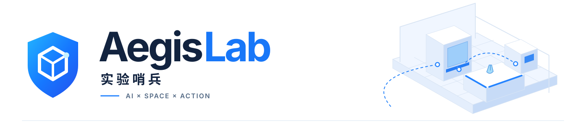
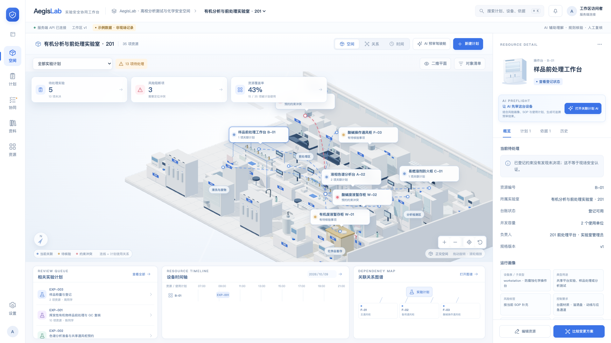
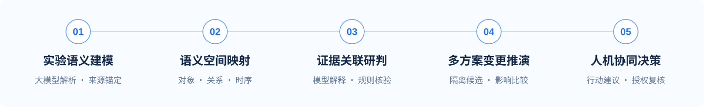

<p align="center">
  <picture>
    <source media="(prefers-color-scheme: dark)" srcset="docs/assets/readme/hero-dark.svg">
    
  </picture>
</p>

<h3 align="center">高校实验场景感知与智能预审平台</h3>
<p align="center">让 AI 读懂实验计划，让空间连接设备、依据与决策。</p>

<p align="center">
  <a href="#overview"></a>
  <a href="#spatial"></a>
  <a href="#architecture"></a>
  <a href="#architecture"></a>
  <a href="#architecture"></a>
  <a href="https://github.com/fanyangzi/AegisLab/actions/workflows/desktop-web.yml"></a>
</p>

<p align="center"><strong>简体中文</strong> · <a href="README.en.md">English</a></p>
<p align="center">
  <a href="#overview">项目介绍</a> ·
  <a href="#highlights">核心优势</a> ·
  <a href="#spatial">AI + 空间建模</a> ·
  <a href="#workflow">工作流</a> ·
  <a href="#quick-start">快速开始</a> ·
  <a href="#architecture">技术架构</a>
</p>

<p align="center">
  <a href="docs/assets/readme/workspace.png"></a>
  <br><sub>空间工作区 · 完整产品界面 · 示例工作区</sub>
</p>

<a id="overview"></a>
## 项目介绍

**实验哨兵（AegisLab）** 面向高校实验准备与安全预审，将大模型辅助理解、三维空间建模、对象关系图谱与协同工作流整合到同一个浏览器工作区。

一份实验计划不仅是一段文字：它关联具体设备、使用时段、控制要求与检查资料。AegisLab 把这些信息组织成可查看、可追溯、可继续办理的场景，让师生和实验室管理人员从**读懂计划**走向**理解条件、比较变更、完成复核**。

> **AI + 场景创新：从文档里的实验，走向可交互、可核验的实验场景。**

当前案例以高校化学实验、样品前处理和分析测试为主要切入点。产品通过网址访问，适用于实验发起人、教师、设备管理员与授权复核人员。

<a id="highlights"></a>
## 核心优势

| 核心能力 | AegisLab 的实现 | 带来的价值 |
| :--- | :--- | :--- |
| **AI 计划理解** | 从 SOP 中整理步骤、设备和控制线索，保留原文位置，并呈现可确认的结构化候选。 | 将非结构化计划接入实际审查流程。 |
| **可交互空间建模** | 房间尺寸、设备类别、位置与朝向驱动 Three.js 场景；设备可选取、聚焦并查看详情。 | 在实验室空间中找到计划涉及的真实业务对象。 |
| **关系与来源联动** | 连接计划、步骤、资源、条件、资料和决策；支持邻域、类型与路径查询。 | 从一个问题追到相应对象、依赖与依据。 |
| **变更方案比较** | 在独立候选中调整资源、时段及受支持字段，查看检查差异，确认后提交新修订。 | 修改安排前先理解影响，保留正式计划与候选的清晰区分。 |
| **证据适用性检查** | 联合核对设备、规格、有效区间、核验状态及冲突记录。 | 判断材料是否支持这次实验的具体使用条件。 |
| **协同预审与复核** | 将问题连接到补证、指派、退回、转交和审批记录；服务端检查权限与当前条件。 | 把分析结果转化为有人负责、能够追踪的后续工作。 |

<a id="spatial"></a>
## AI + 空间建模

**AI 提供计划的语义理解，空间建模提供对象上下文，规则与人员共同完成预审。**

AegisLab 以房间和资源配置构建三维实验室，再将计划中的设备引用、检查结果和业务动作连接到对应对象。空间由配置驱动，AI 理解与场景对象通过同一套业务身份关联。

| 同一工作区的三种视图 | 重点回答的问题 |
| :--- | :--- |
| **空间 · Space** | 实验在哪里进行？涉及哪些设备？当前选中对象关联什么计划？ |
| **关系 · Graph** | 这项计划依赖什么？问题连接哪些条件与资料？依据从哪里来？ |
| **时间 · Timeline** | 何时使用资源？是否与维护或其他计划重叠？证据是否覆盖使用时段？ |

三种视图共享计划、设备与工作区数据。用户可以从设备进入计划，从关系查看依据，再切到时间视图理解资源安排；AI 分析中的对象与来源动作也能回到相应工作位置。

**空间是操作入口，图谱是解释路径，时间是条件上下文。** 三者一起支持具体实验的理解、预审与变更处理。

<a id="workflow"></a>
## 从实验计划到协同决策

<p align="center"></p>

1. **导入与理解**：上传 TXT、Markdown、DOCX 或带文本层的 PDF，保存计划原文并核对步骤和对象匹配。
2. **场景关联与预审**：结合设备台账、资源使用时段和相关资料进行检查；调用 AI 辅助解释问题、整理后续建议。
3. **比较与办理**：建立候选方案，查看变更影响，创建或指派补充资料、协调和复核任务。
4. **确认与留痕**：授权人员完成决策，系统保留依据和操作记录；条件改变后重新检查关联结果。

例如，某项计划需要共享通风柜。用户能从实验室中选中设备，查看关联计划与检查记录，再比较调整时段或更换资源后的结果。**计划、空间、依据和动作始终围绕同一个实验上下文展开。**

<a id="quick-start"></a>
## 快速开始

### 1. 安装环境

使用 **Node.js 22.12+（22.x）** 和 **Python 3.12**。以下为 macOS / Linux 命令：

```bash
git clone https://github.com/fanyangzi/AegisLab.git
cd AegisLab

npm ci
python3 -m venv .venv
source .venv/bin/activate
python -m pip install -r backend/requirements-dev.txt
test -f .env || cp .env.example .env
```

Windows 可使用 `.venv\Scripts\Activate.ps1` 激活虚拟环境。已有 `.env` 请保留，按 [配置示例](.env.example) 补充需要的字段。

### 2. 启动网页

**终端一：启动 API**

```bash
source .venv/bin/activate
uvicorn backend.main:app --env-file .env --host 127.0.0.1 --port 8000 --reload
```

**终端二：启动前端**

```bash
npm run dev
```

在浏览器打开 **http://127.0.0.1:5173/**。开发环境建议将 `VITE_API_BASE_URL` 留空，由 Vite 代理 `/api` 请求。

首次进入后，可建立自己的实验室与设备，也可主动导入示例工作区，再从一份计划开始体验空间、关系、时间与辅助预审。

### 3. 连接模型

在服务端 `.env` 中填写模型服务配置，保存后重启 API：

```dotenv
LABSAFETY_LLM_ENABLED=1
LABSAFETY_LLM_BASE_URL=
LABSAFETY_LLM_MODEL=
LABSAFETY_LLM_API_KEY=
```

`BASE_URL` 填写兼容模型 API 的基础地址，`MODEL` 填写该服务提供的模型标识，`API_KEY` 填写自己的服务凭据。适配器优先使用 Responses 接口，并对不支持该接口的服务尝试 Chat Completions。

在计划中打开 AI 辅助预审即可触发分析。**模型负责候选理解与解释，规则负责条件核验，授权人员负责最终复核。** 密钥仅放在服务端，不写入 `VITE_*` 变量或 Git。

<details>
<summary><strong>部署为同源网站</strong></summary>

```bash
npm run build
AEGIS_SERVE_WEB=1 uvicorn backend.main:app --env-file .env --host 127.0.0.1 --port 8000
```

浏览器打开 **http://127.0.0.1:8000/**，由 FastAPI 同时提供网页和 API。先停止占用同一端口的开发服务。公网部署配置 HTTPS 与访问控制；可通过 `AEGIS_WORKSPACE_TOKEN` 配置工作区访问令牌，并在网页设置中连接。

</details>

<a id="architecture"></a>
## 技术架构

| 层次 | 技术与职责 | 代码入口 |
| :--- | :--- | :--- |
| **网页工作区** | React、TypeScript、Vite；页面、对象选择、表单与跨视图上下文。 | [`src/web/`](src/web/) |
| **空间与交互** | Three.js；参数化设备、场景建模、相机、选取与标签。 | [`Scene.tsx`](src/web/Scene.tsx) |
| **语义理解** | 模型适配、SOP 结构化候选、来源锚定与问题解释。 | [`llm.py`](backend/app/llm.py) · [`parser.py`](backend/app/parser.py) |
| **业务与核验** | FastAPI；资源条件、关系查询、分支、资料、协作及决策。 | [`spatial.py`](backend/app/spatial.py) |
| **数据与后台任务** | SQLite、修订与幂等、持久化任务和独立 Worker。 | [`worker.py`](backend/worker.py) |

<details>
<summary><strong>开发检查</strong></summary>

```bash
npm run test:parity
npm run build
python -m unittest discover -s tests -p 'test_*.py' -v
python tests/smoke.py
```

覆盖前后端领域规则对照、接口、资料处理、协作状态、权限、并发与持久化等工程路径。

</details>

## 参与项目

欢迎通过 [Issues](https://github.com/fanyangzi/AegisLab/issues) 提交使用反馈、场景需求或问题复现，通过 [Pull Requests](https://github.com/fanyangzi/AegisLab/pulls) 参与开发。设备类别与知识来源可查阅 [设备调研](docs/equipment-taxonomy-research.md) 和 [来源登记](data/knowledge_sources.json)。

<p align="center"><strong>实验哨兵 · AegisLab</strong><br><sub>知微守安队 · AI + 场景创新</sub></p>
